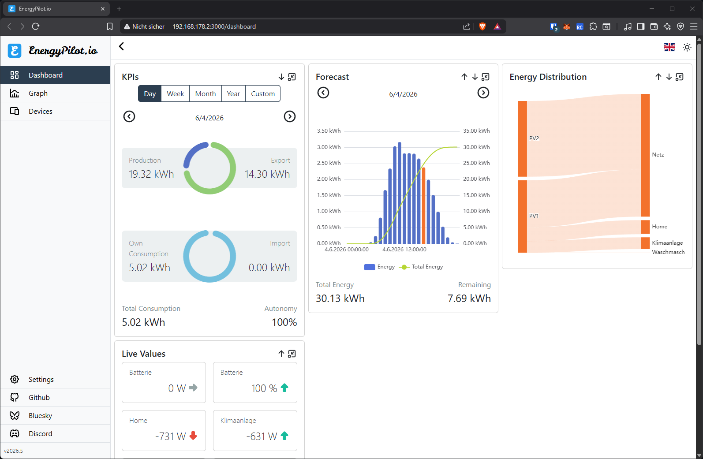
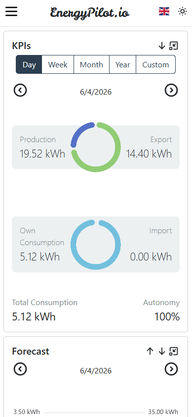
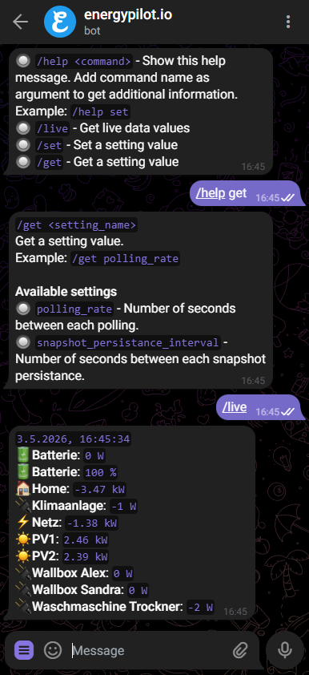

# EnergyPilot.io

EnergyPilot.io is an easy to use and feature rich Energy Management Platform focused on homes with solar energy production.





## Features

⚡ Modern and clean user interface

⚡ Easy to configure and use

⚡ Ready to use Docker image

⚡ Integrated Telegram bot

⚡ Multilanguage support

⚡ Light/Dark theme

## Supported devices

### Solar systems

- Sungrow Hybrid
- Sungrow Wallbox AC011E-01

### Wallboxes

- ABL emh1/2/4

### Other consumers

- TP-Link Tapo P1xx

## Support

Join us on Discord
<a href="https://discord.gg/YAsTew8m92" target="_blank">EnergyPilot.io@Discord</a>

If you would like to support this project, please consider buying me a coffee.

<a href="https://www.buymeacoffee.com/nekronomekron" target="_blank"></a>

## Quickstart

### Docker Registry Image

The published `energypilot/energypilot:latest` image can be started directly with Docker. Persist `/data`; the container reads an optional `/data/.env` before starting the server. Variables explicitly supplied by the container platform take precedence.

Create the data directory and a token file:

```sh
mkdir -p data
printf 'API_PASSWORD=energypilot\n' > data/.env
chmod 600 data/.env
```

`energypilot` is the initial password. Replace it with any password you choose, for example `API_PASSWORD=my-private-password`. Set `API_PASSWORD=` to disable password prompts; the dashboard then displays a warning because anyone with network access can make changes.

Start the registry image and mount the same directory for persistent data:

```sh
docker run -d --name energypilot-io --restart unless-stopped \
  -p 3000:3000 -e HOST=0.0.0.0 \
  -v "$(pwd)/data:/data" energypilot/energypilot:latest
```

Alternatively, configure `API_PASSWORD` directly in the container platform's environment settings and omit `data/.env`. The dashboard reads pages and live values without a password and prompts for the password only when changing devices or settings. MCP requests require the password; Telegram continues to require an allowed user ID.

### Advanced: Docker Compose

Compose is an optional advanced deployment path. The provided `compose.yaml` mounts `./data` at `/data`, so the same `data/.env` file works without a project-root `.env` file. To override the data-directory file, add `API_PASSWORD` to the service's `environment` section:

```sh
docker compose up -d
```

## Create Telegram bot token

- Start a chat with <a href="https://t.me/botfather" target="_blank">@BotFather</a> on Telegram
- Send the command `/newbot` and follow the instructions in the chat
- After completing all steps, the Telegram bot token will be created and returned in the chat
- Paste the token into the settings page of your EnergyPilot.io instance
- Configure the Telegram user IDs allowed to use the bot; access is denied until at least one ID is set
- Send `/id` to the bot to find your Telegram user ID before adding it to the allowlist
- You can start chatting to your created bot and interact with your EnergyPilot.io instance from anywhere in the world

## Setup Development Environment

### Requirements

- Node.js installation >= 24.14.1
- Clone/Download the Git Repository to your local drive

### Setup environment

Install all Node.js dependencies

```
npm i
```

Install all Node.js dependencies for the server

```
cd ./server/
npm i
```

Build the Angular application and start your local instance

```
npm run start
```

## Contributing

We welcome contributions! See [CONTRIBUTING](CONTRIBUTING.md) for guidelines.

[](https://github.com/energypilot-io/energypilot-io/graphs/contributors)
